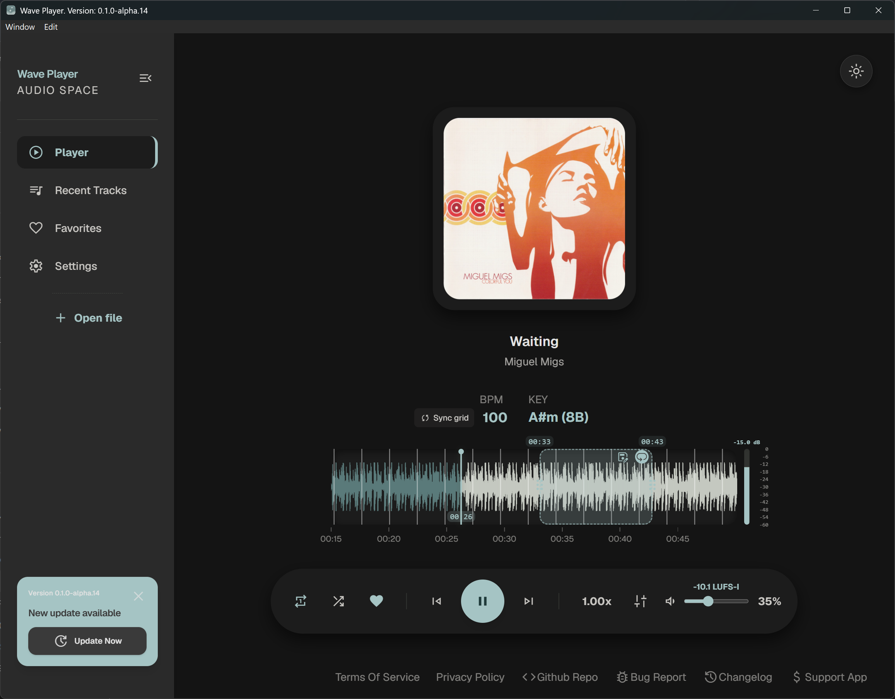
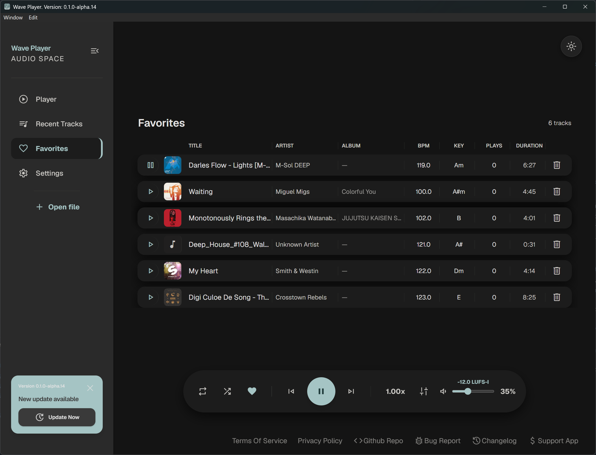
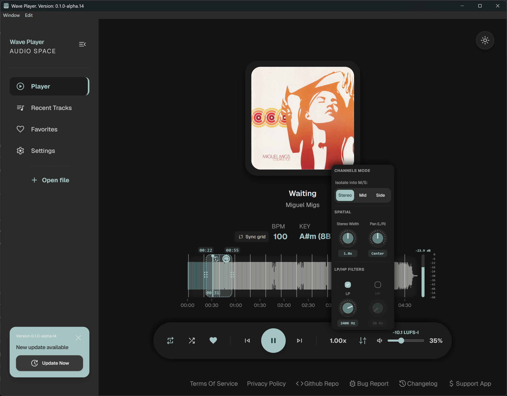
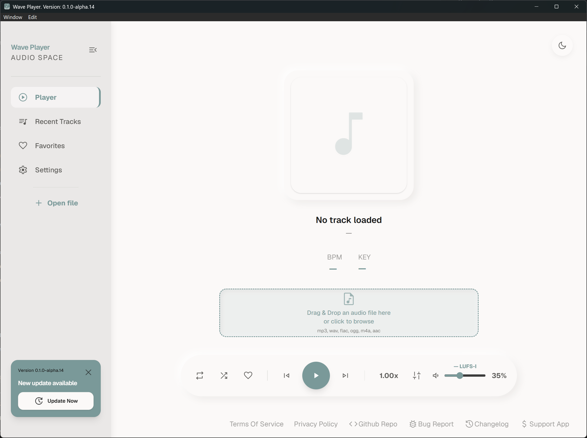
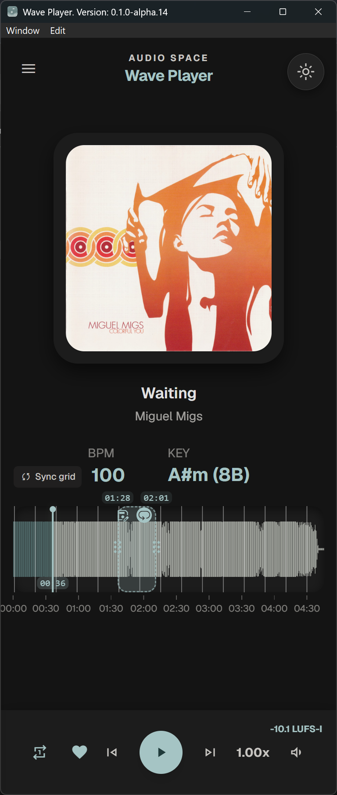

# Wave Player

[](LICENSE)
[](https://www.rust-lang.org/)
[](https://dioxuslabs.com/)

> [!WARNING]
> **Unstable alpha software.** Expect crashes, audio glitches, incomplete
> features, and breaking changes. Back up the `wave_player_data` directory
> before testing a new build.

Wave Player is a desktop music player and audio playground built with Rust and
Dioxus. It combines waveform navigation with real-time processing: looping,
time stretching, filters, stereo tools, track analysis, and WAV export.

Prebuilt installers and portable archives for Windows, macOS, and Linux are
published in [GitHub Releases](../../releases). Portable Windows and Linux
binaries are compressed with UPX (some antivirus tools may flag packed
executables). Builds are unsigned; on macOS, right-click the app and choose
**Open** the first time.

## Screenshots

Screenshots from the Windows build:

| Player | Favorites |
| --- | --- |
| [](screenshots/main_view.png) | [](screenshots/favorites_list.png) |

| Filters and spatial controls | Light theme |
| --- | --- |
| [](screenshots/filters.png) | [](screenshots/light_theme.png) |

<p align="center">
  <a href="screenshots/compact_view.png">
    
  </a>
</p>

## Features

- **Playback:** play, pause, seek on the waveform, adjustable speed with
  optional pitch preservation, volume, whole-track repeat, and loop regions.
- **Real-time processing:** low-pass and high-pass filters, stereo width, pan,
  Mid/Side monitoring, and smooth parameter changes.
- **Analysis:** waveform, BPM, musical key, beat grid, LUFS loudness, and
  metadata. Latest-request-wins scheduling with persistent caching.
- **Beat grid:** editable BPM, manual grid sync, per-track tempo and anchor
  persistence, and optional timeline snapping.
- **Library and settings:** recently played tracks, favorites, SQLite storage,
  persistent settings, window geometry, and per-track analysis tools.
- **Updates:** automatic checks from GitHub Releases with in-app download and
  restart (Windows portable builds first).
- **Export:** export the loop region to WAV with speed and effects applied.
- **Interface:** dark and light themes, responsive desktop/mobile layout, and
  bundled fonts and icons.

## Supported audio formats

MP3, WAV, OGG/Vorbis, FLAC, AAC, and AIFF. Decoding is provided by
`rodio`/Symphonia; actual support depends on the file encoding.

## Technology stack

- Rust 1.85+ (edition 2024)
- Dioxus 0.7 and Tailwind CSS 4
- rodio 0.22 / Symphonia
- stratum-dsp, ebur128, timestretch, math-iir-fir
- hound, rusqlite/SQLite, audiotags
- flume and async-broadcast

## Architecture

The UI and audio engine communicate through explicit commands and events. The
store thread handles SQLite, JSON configuration, and caches independently.

```text
Dioxus UI ──PlayerCommand──▶ Audio engine ──PlayerEvent──▶ Dioxus UI
Dioxus UI ──StoreCommand───▶ Store thread ──StoreEvent───▶ Dioxus UI
                               (SQLite, config, cache)
```

## Requirements

- Rust 1.85+ and Cargo
- Node.js LTS and pnpm
- Dioxus CLI: `cargo install dioxus-cli`
- System webview: WebView2 on Windows, WebKitGTK on Linux, WKWebView on macOS
- Linux packages: `libwebkit2gtk-4.1-dev`, `libgtk-3-dev`,
  `libayatana-appindicator3-dev`, `libxdo-dev`, `librsvg2-dev`,
  `libasound2-dev`

The build embeds `assets/tailwind.css`, so build the stylesheet before
compiling:

```sh
pnpm install
pnpm build:css
```

## Running

```sh
pnpm build:css
dx serve --platform desktop
```

Android support is experimental: `pnpm build:css && dx serve --platform android`.

## Building a release

```sh
pnpm build:css
dx bundle --release --platform desktop --package-types <deb|dmg|msi>
```

Bundle formats depend on the target platform. CI builds the native package and
portable archives only for version tags, then publishes them to GitHub Releases.
Pushes to `main` without a tag run the checks but publish nothing.

To publish a release, bump `version` in `Cargo.toml`, refresh the lockfile,
commit both files, and push a tag with the same version:

```sh
# version = "0.1.0-alpha.16" in Cargo.toml
cargo check
git add Cargo.toml Cargo.lock
git commit -m "chore(release): 0.1.0-alpha.16"
git tag v0.1.0-alpha.16
git push origin main
git push origin v0.1.0-alpha.16
```

CI fails if the tag does not match the `Cargo.toml` version.

## Data directory

Wave Player stores the SQLite database, `config.json`, and analysis caches in
`wave_player_data` next to the executable when that directory is writable
(portable and development layout); the WebView cache lives in `webview_cache`
beside it. Installed builds fall back to the platform user data directory:
`%LOCALAPPDATA%\Wave Player`, `~/Library/Application Support/Wave Player`, or
`$XDG_DATA_HOME/wave-player` (`~/.local/share/wave-player`), and keep the
WebView cache there as well.

## Project status

Wave Player is a personal project created to build a convenient and modern
audio player for everyday use.

The idea came from my own experience as both a music producer and a regular
listener. Existing music players often provide only basic playback controls,
while useful information such as waveform visualization, BPM, musical key,
loudness, metadata, and loop-based listening is either unavailable or separated
across different tools.

Wave Player aims to bring these features together in one focused application
for listening to, exploring, and analyzing music.

The main goals are:

- Build a convenient audio player for personal everyday use.
- Create a modern tool for both music production and casual listening.
- Make additional track analysis available directly during playback.
- Combine waveform visualization, BPM, key, metadata, and audio controls in one
  interface.
- Explore real-time audio processing and DSP with Rust.
- Develop a maintainable foundation for future audio tools.
- Experiment with desktop and mobile application development using Dioxus.

## Current limitations

- Windows is the primary platform; Linux, macOS, and Android builds are
  experimental.
- Playback position uses the engine clock and is not sample-accurate.
- First-time analysis of long tracks can be CPU-heavy; later runs use the cache.
- Changing pitch-preservation mode may rebuild the audio pipeline.
- Cache/database recovery, audio device hot-swap, playlists, and crossfade are
  not implemented yet.
- In-app updates currently support Windows portable builds; macOS and Linux
  update paths are planned.

## Roadmap

- [ ] Playlists and queue management
- [ ] Crossfade and automatic gain between tracks
- [ ] Parametric EQ, compressor, and limiter
- [ ] VST3/CLAP plugin hosting
- [ ] Improved accessibility and mobile interaction

## Development principles

- Keep the audio engine independent from the UI and never block the real-time
  path.
- Communicate through explicit commands and validate parameters before they
  reach the pipeline.
- Keep real-time and offline processing behavior consistent.

## Development commands

```sh
cargo fmt
cargo check --all-targets --features desktop
cargo test --features desktop
node --test tests/beat_grid.test.cjs
pnpm build:css
```

CI runs the Rust and JavaScript tests on Windows, macOS, and Linux.

## Reporting issues

Include the OS and version, Wave Player version or commit, reproduction steps,
audio format, console output, and whether the issue reproduces with a clean
`wave_player_data` directory. Do not upload copyrighted music; a short synthetic
test file is enough.

## Contributing

Bug reports and pull requests are welcome. For significant changes, open an
issue first so the approach can be discussed.

## License

Wave Player is distributed under the MIT License. See [LICENSE](LICENSE).
