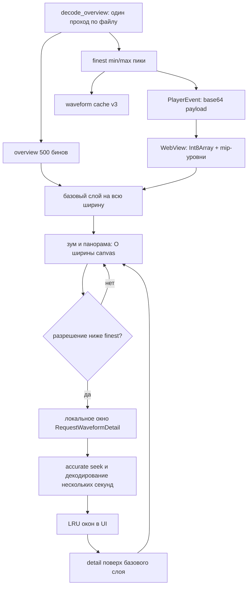

# Design

## Проблема

### 1. Детальная волна декодируется от начала файла

`src/backend/analysis/service.rs`, `analyze_detail` (строки 796–879) открывает декодер и идёт циклом `for frame_index in 0..end_frame`, пропуская кадры до `start_frame` уже после декодирования:

```rust
for frame_index in 0..end_frame {
    if !read_frame(&mut decoder, &mut frame) { break; }

    if frame_index < start_frame {
        continue; // кадры до окна всё равно прочитаны и декодированы
    }
    // ...
}
```

Для часового микса при зуме у конца это десятки миллионов кадров на каждый запрос. Стоимость линейна по длине трека и не зависит от размера видимой области.

### 2. UI запрашивает детализацию на каждое изменение вьюпорта

`src/gui/components/waveform_bins_canvas.rs` (строки 862–915) запускает эффект на каждый тик `zoom`/`view_center` и отправляет `RequestWaveformDetail`. `detail_request_pending` блокирует новый запрос до ответа, поэтому устаревшее декодирование нельзя вытеснить. Запас предзагрузки `3.0` и фиксированные `4096` точек дополнительно увеличивают окно.

### 3. Пустая левая часть при быстром Zoom Out

`animateFrame` начинает кадр с `ctx.clearRect(0, 0, width, height)`. Если в памяти есть detail, функция вызывает `drawDetailWaveform(...)` и сразу делает `return`, не рисуя overview:

```js
ctx.clearRect(0, 0, width, height);
// ...
if (detail && detail.points && detail.points.length > 0) {
    drawDetailWaveform(detail, startFraction, visibleFraction);
    updateWaveViewportVariables();
    return;
}
```

`drawDetailWaveform` рисует только точки, попавшие в текущий viewport, и пропускает остальные (`if (nextX < 0 || x > width) continue`). После быстрого Zoom Out вьюпорт становится шире загруженного detail-окна: очищенная левая часть не покрывается ни одной точкой и остаётся прозрачной, а overview как fallback не используется. Это ровно то, что видно на скриншоте.

### 4. Нет предрасчитанных данных для зума

Overview хранит `500` бинов на весь трек. Любой зум глубже этого требует декодирования. Стандартный подход к волне — многоуровневая пиковая пирамида, из которой вьюпорт собирается за число операций порядка ширины canvas. В текущем коде её нет.

## Почему не отдельный декодер

Отдельная сущность декодера не нужна. Нужен режим seek:

- воспроизведению нужен быстрый `coarse` seek, точность там не критична;
- локальному окну крайнего зума нужен `accurate` seek, иначе первый прочитанный кадр не соответствует `start_frame` и волна смещается.

Существующий конструктор в `src/backend/decoder.rs` параметризуется:

```rust
#[derive(Clone, Copy)]
pub(crate) enum SeekAccuracy {
    Coarse,
    Accurate,
}

pub(crate) fn open_file_with_decoder(
    path: &Path,
    seek: SeekAccuracy,
) -> Result<Decoder<BufReader<File>>, AudioError>
```

`build_audio_pipeline` передаёт `Coarse`, локальное окно — `Accurate`. Основной путь зума вообще не открывает декодер: он рисует из пиковой пирамиды, которая строится один раз при анализе.

## Целевая архитектура



## 1. Модель пиков и построение

Новый тип в `analysis/service.rs`:

```rust
#[derive(Clone)]
struct WaveformPeaks {
    sample_rate: u32,
    total_frames: usize,
    bin_frames: usize,
    /// Пары i8: min, max для каждого бина.
    bins: Vec<i8>,
}

const PEAK_BIN_FRAMES: usize = 128; // ~2.9 мс при 44.1 кГц
const MAX_PEAK_BINS: usize = 4_000_000;
```

Правила:

- `bin_frames = max(PEAK_BIN_FRAMES, next_power_of_two(ceil(total_frames / MAX_PEAK_BINS)))`;
- при `need_waveform == true` в существующем цикле `decode_overview` параллельно с overview накапливаются `min`/`max` по всем каналам кадра; раздельная отрисовка каналов не входит в этот change, волна остаётся моно-суммой;
- после прохода значения квантуются в `i8`: `round(clamp(value, -1, 1) * 127)`, пары пишутся подряд;
- число бинов обрезается по фактически прочитанным кадрам;
- при выходе за `MAX_PEAK_BINS` пики не сохраняются, но overview и LUFS завершаются как раньше;
- overview остаётся `500` бинов и не меняет формат `WaveformChunkReady`.

Отдельного прохода по файлу нет: пики — побочный продукт уже существующего анализа.

## 2. Кэш waveform версии 3

`src/backend/waveform_cache.rs`:

- `CACHE_VERSION` повышается до `3`;
- `load` возвращает `CachedWaveform { peaks: Vec<f32>, waveform_peaks: Option<CachedWaveformPeaks> }`;
- после overview-секции файл содержит `sample_rate u32`, `total_frames u64`, `bin_frames u32`, `bin_count u32` и `bin_count * 2` байт `i8`;
- валидируются `sample_rate > 0`, `total_frames > 0`, `bin_frames > 0`, `bin_count <= MAX_PEAK_BINS`, точная длина данных и отсутствие хвоста;
- `save` пишет обе секции в тот же атомарный временный файл через `rename`;
- `CachedAnalysis` получает `#[serde(skip)] waveform_peaks: Option<WaveformPeaks>`;
- `CachedAnalysis::complete()` дополнительно требует пики, поэтому кэш без них пересобирается.

Миграция не нужна: `SourceStamp` версии 3 не совпадает со старыми файлами, они возвращают `Ok(None)` и пересоздаются. Старые файлы остаются на диске и удаляются существующим `clear_analysis_cache`.

## 3. Событие и повторная доставка

`PlayerEvent` получает вариант:

```rust
WaveformPeaksReady {
    sample_rate: u32,
    total_frames: usize,
    bin_frames: usize,
    /// base64 от упакованных пар i8 min/max.
    encoded: Arc<str>,
}
```

- кодирование base64 выполняется один раз в фоновом analysis-потоке;
- `Arc<str>` делает клонирование события при broadcast дешёвым;
- `AnalysisService` хранит последний payload и повторяет событие в `replay_overview`, чтобы после ухода с экрана и возврата компонент снова получил пики без повторного анализа;
- на `PlayerEvent::Started` UI очищает пики и запрашивает overview, что инициирует replay.

Контракт `PlayerCommand` не меняется: запрос пиков идёт через существующий `RequestWaveformOverview`.

## 4. Клиентская пирамида и рендер

### 4.1 Декодирование payload и mip-уровни

`WAVEFORM_JS` в `waveform_bins_canvas.rs` заменяется на рендер из пиков:

1. Получив `encoded`, JS делает `atob`, превращает строку в `Int8Array` и рассматривает её как пары `min/max`.
2. Строит mip-уровни один раз за трек:

```js
function buildPeakLevels(level0) {
    const levels = [level0];
    let current = level0;
    while (current.length > 2) {
        const next = new Int8Array(Math.ceil(current.length / 4));
        for (let i = 0; i < next.length; i += 2) {
            // min = min(двух min), max = max(двух max)
        }
        levels.push(next);
        current = next;
    }
    return levels;
}
```

### 4.2 Выбор уровня детализации

```js
const framesPerPixel = visibleFrames / canvasWidth;
const level = levels.findLastIndex(level => level.binFrames <= framesPerPixel);
```

Если `framesPerPixel < binFrames[0]`, включается режим локального окна (раздел 6). При правильном выборе уровня на пиксель приходится 1–2 бина, поэтому кадр стоит `O(width)`, а не `O(бинов)`. Все вычисления ведутся относительно начала вьюпорта; абсолютные индексы кадров не приводятся к `f32`.

### 4.3 Композиция слоёв и запрет пустых участков

Каждый кадр строится снизу вверх, и ни один шаг не оставляет прозрачных колонок:

1. **Базовый слой на всю ширину.** На дальнем зуме (до ~`8×`) сохраняется overview `500` бинов, растянутый на вьюпорт, как в предыдущей версии: отдельные столбцы с зазорами и скруглёнными углами. Начиная с ~`8×`, если пиковая пирамида уже загружена, используется подходящий mip-уровень. Если пиков ещё нет — overview. Если нет и overview (трек ещё не анализировался) — нейтральный placeholder на всю ширину.
2. **Слой локального окна.** Если есть окно крайнего зума, оно рисуется поверх базового только в своём диапазоне кадров. Вне диапазона остаётся базовый слой.
3. **Никакого раннего `return` после detail.** `clearRect` допустим только в начале кадра, если в этом же кадре базовый слой гарантированно перерисовывает всю ширину. Нельзя повторить текущий баг, когда detail-ветка возвращается, не заполнив остальное.
4. **Частичное покрытие.** Если detail-окно покрывает левую или правую часть вьюпорта, остальная часть дорисовывается из mip/overview. Границы слоёв совпадают по времени, поэтому не возникает разрыва или двойного столбика.
5. **Устаревший ответ.** Пришедшее окно старого `request_id` не применяется к текущему вьюпорту, но кладётся в LRU, если его диапазон и разрешение ещё полезны.

Таким образом, быстрый Zoom Out мгновенно показывает более грубую форму сигнала по всей ширине, а детализация уточняется по мере готовности окон без пустых областей и без мигания.

### 4.4 Отрисовка canvas

- В плотной волне рисуется один `fillRect` на пиксель; `roundRect` и `beginPath` используются только когда ширина столбика больше ~3 px.
- Цвет played/unplayed рисуется двумя проходами с одним переключением `fillStyle` вместо переключения на каждый столбик.
- Анимация появления — один общий коэффициент высоты на кадр, без LERP-прохода по всем бинам.
- Debug-объект `window.waveformStats` хранит выбранный LOD, `framesPerPixel`, число fallback/detail колонок и время кадра.

## 5. Владение зумом и синхронизация вьюпорта

- `window.waveZoom` и `window.waveScroll` остаются источником истины для canvas. `zoomAt`, `panBy`, `handleWaveWheel` обновляют их и планируют перерисовку через `requestAnimationFrame`; перерисовка не ждёт Rust.
- Существующий `onwheel` в Rust продолжает получать итоговое `{zoom, scroll}` и обновлять сигналы `zoom`/`view_center`, но обновления сигналов коалесцируются: не чаще одного раза примерно за 50 мс и один финальный раз после остановки жеста.
- Canvas не зависит от перерисовки Dioxus-дерева. Loop-оверлеи, beat grid и шкала времени могут догонять вьюпорт с задержкой до ~100 мс; итоговое положение совпадает с волной.
- `BeatGrid` уже рисуется в JS из `window.waveZoom/waveScroll`, поэтому он обновляется вместе с волной без Rust-сигналов.
- Стрелки/клавиатурный seek и клик по таймлайну не меняются: они по-прежнему отправляют `PlayerCommand::Seek`.

## 6. Крайний зум: локальные окна

Когда `framesPerPixel < binFrames` finest-уровня, mip-пирамида уже не даёт разрешения. Тогда:

- UI запрашивает окно `3 × видимой области` (с клампом к границам трека) через существующий `PlayerCommand::RequestWaveformDetail`;
- `points = 4096` (бэкенд дополнительно ограничивает число точек фактическим числом кадров, поэтому на максимальном зуме получаются почти sample-level бины);
- бэкенд декодирует только это окно и возвращает `WaveformDetailReady` без изменения протокола;
- UI хранит до четырёх последних окон в LRU. Если видимая область покрыта окном с достаточным разрешением, новый запрос не отправляется; зум туда-обратно по уже просмотренным участкам не декодирует аудио;
- запросы крайнего зума коалесцируются короткой паузой (~50 мс) и вытесняются по `request_id`, но только в этом режиме;
- окно выравнивается по `start_frame / sample_rate` и декодируется `Accurate`-декодером. Если точный seek недоступен, используется последовательный проход от нуля, но окно остаётся маленьким по числу запрошенных точек.

Худший случай декодирования ограничен размером окна, а не длиной трека: при `width = 1200 px`, `bin_frames = 128`, `44.1 кГц` это около 10 секунд аудио.

## 7. Бюджеты и размеры

| Трек | finest-бинов | Кэш (i8 min/max) | base64 | Порог локальных окон |
| --- | ---: | ---: | ---: | ---: |
| 5 минут | ~103 000 | ~207 КБ | ~275 КБ | ~86× |
| 1 час | ~1 240 000 | ~2.5 МБ | ~3.3 МБ | ~1030× |
| 10 часов (cap) | ~3 100 000 | ~6.2 МБ | ~8.3 МБ | ~260× |

- JS-память: finest + mip-уровни примерно вдвое больше finest, то есть ~5 МБ для часа.
- Рендер: около 1200 пикселей и 1–2 бина на пиксель, порядка 2–3 тысяч чтений на кадр.
- Передача пиков — разовая на трек; при смене трека массивы заменяются и старые освобождаются.

## 8. Что из рекомендованной tiled-архитектуры не внедряется

| Рекомендация | Решение |
| --- | --- |
| Multiresolution Peak Pyramid | Внедряется: finest-уровень строится при анализе, mip-уровни — в JS. |
| Tiled Cache | Не нужен: полный finest-уровень для текущего трека занимает ~2.5 МБ на час и строится в уже существующем проходе. Ленивая загрузка тайлов не даёт выигрыша. |
| Progressive Rendering | Внедряется явно: базовый слой + detail, fallback по участкам, запрет пустых колонок. |
| Background Scheduler | Используется существующий `Latest`-воркер: одно ожидающее задание, дедупликация заменой, отмена по `Token`. Новых потоков на каждый зум нет. |
| Viewport-only Rendering | Внедряется: рисуются только видимые пиксели, математика относительна началу вьюпорта. |
| 64-битные индексы | В Rust — `usize`/`u64`; в JS — относительные вычисления без приведения больших кадров к `f32`. |
| Инвалидация по fingerprint | Уже есть через `SourceStamp` (путь, размер, mtime) и версию кэша. |
| Placeholder только без данных | Внедряется: placeholder только если нет ни overview, ни пиков. |
| Prefetch | Локальное окно крайнего зума загружается с запасом `3 ×` видимой области и 4096 точками. |
| Generation id | Существующий `request_id`: устаревший ответ не применяется, но остаётся в LRU. |
| Raster/bitmap cache | Не нужен: перерисовка из пиков уже `O(width)`. |

## Рассмотренные альтернативы

- **Только accurate seek без пирамиды.** Отклонено: каждый зум всё равно требует запроса в бэкенд, а средний зум на длинных файлах остаётся медленным.
- **Увеличить overview с 500 до десятков тысяч бинов.** Отклонено: рендер всё равно проходит по бинам, а не по пикселям, и не покрывает глубокий зум; растёт стоимость анимации.
- **Держать весь файл как PCM в памяти.** Отклонено: час стерео во `f32` — около 1.2 ГБ.
- **Рендерить вьюпорт на бэкенде и присылать картинку на каждый зум.** Отклонено: IPC и сериализация на каждый кадр жеста.
- **LRU декодированных окон без пирамиды.** Отклонено: первый зум в новое место на часовом миксе декодирует минуты аудио.
- **Полноценный tiled cache с scheduler.** Отклонено для этого change: whole-file анализ уже есть, а пики для часа весят меньше, чем несколько секунд PCM. Если появятся треки на десятки часов или потребуется streaming-загрузка, tiled-подход можно добавить отдельным change.

## Тест-план

| Требование | Проверка |
| --- | --- |
| Zoom and pan render from precomputed peaks | Node-тест: `choosePeakLevel` и агрегация дают ожидаемые min/max; число `fillRect` порядка ширины canvas; путь колеса не вызывает команд загрузки. Manual smoke: часовой микс, быстрый зум у конца. |
| Progressive fallback prevents empty viewport regions | Node-тест с частичным detail: все пиксельные колонки получают данные из detail или mip/overview; `clearRect` не оставляет прозрачных колонок. Manual smoke: быстрый Zoom Out после загруженного detail. |
| Multi-resolution peak pyramid | Unit-тесты `build_waveform_peaks`: число бинов, шаг, min/max известных всплесков, квантование, cap. Node-тесты `buildPeakLevels` и выбора уровня. Integration-тест загрузки пиков из кэша и replay. |
| Extreme zoom uses bounded local windows | Unit/integration-тест `decode_detail_window`: окно не с нуля, маркер, `frames_read` близко к `frame_count`. Node-тест LRU: повторный вход в окно не отправляет запрос. Manual smoke максимального зума. |
| Viewport synchronization does not block zoom rendering | Node-тест: wheel/pan меняют `waveZoom`/`waveScroll` и планируют кадр без `dioxus.send` команды загрузки. Manual smoke: быстрый жест, оверлеи догоняют ≤100 мс. |
| Peak rendering stays aligned with the timeline | Node-тесты с маркерами на mip и локальном окне; unit-тест окна, начинающегося не с нуля; manual smoke перехода finest-границы. |
| Waveform cache version 3 upgrades without losing user data | Integration-тесты `waveform_cache`: round-trip overview + пиков, отказ `SourceStamp::version = 2`, обрезанный файл, `bin_frames = 0`, превышение лимита. Manual smoke после обновления. |

Дополнительно:

- `cargo fmt --check`;
- `cargo check --all-targets --features desktop`;
- `cargo test --locked --features desktop`;
- `node --test tests/waveform_pyramid.test.cjs`;
- покрытие изменённых Rust-модулей при наличии `cargo llvm-cov`;
- mutation testing только для новой чистой логики (`build_waveform_peaks`, `decode_detail_window`), опционально, с бюджетом 5 минут;
- manual smoke: часовой MP3/WAV, зум у конца, быстрый Zoom Out после detail, быстрое колесо, панорамирование, максимальный зум, переключение трека во время запроса, уход с экрана и возврат, перезапуск с кэшем v3, повреждённый кэш;
- `window.waveformStats` в manual smoke: LOD, `framesPerPixel`, fallback/detail колонки и время кадра не должны показывать провалов на быстром зуме.

## Риски

- **Композиция слоёв.** При частичном покрытии detail легко получить разрыв или двойную отрисовку на границе. Detail накладывается только на свой диапазон, базовый слой рисуется на всю ширину; это покрывается Node-тестом с частичным окном.
- **Размер разовой передачи.** Для часа это ~3.3 МБ base64. Кодирование выполняется в фоновом потоке, но `atob` и разбор в WebView занимают десятки миллисекунд. Если smoke покажет заметный jank, payload можно передавать чанками без изменения архитектуры.
- **Память WebView.** Finest + mip-уровни для часа — около 5 МБ; при смене трека массивы заменяются. Для экстремально длинных файлов cap ограничивает размер, а глубокий зум уходит в локальные окна.
- **Размер кэша.** Finest-пики для часа — около 2.5 МБ, для библиотеки из тысячи пятиминутных треков — около 200 МБ. Это осознанный обмен диска на мгновенный зум; при необходимости шаг finest-уровня можно увеличить без изменения архитектуры.
- **Точность seek зависит от формата.** Для форматов без `time_base` остаётся последовательный резервный путь; корректность проверяется маркером в WAV и manual smoke MP3/FLAC/OGG.
- **Задержка оверлеев.** Loop-маркеры и шкала могут отставать от canvas до ~100 мс во время жеста. Это компромисс ради независимой от Dioxus отрисовки; итоговое положение совпадает.
- **Один eval на тик колеса.** Текущий путь колеса остаётся событием Rust → JS → Rust, но теперь он не загружает данные и не перерисовывает дерево. Если smoke покажет jank, следующим шагом будет постоянный JS-канал и нативные слушатели.
- **Квантование i8.** Погрешность около 0.008 по амплитуде; для отображения волны незаметна. Если после квантования `min > max`, пара нормализуется в `0/0`.
- **Старые кэши.** После обновления waveform-кэши пересоздаются при первом анализе каждого трека; это фоновая операция на пониженном приоритете.

## Затронутые компоненты и данные

- `src/backend/analysis/service.rs` — `WaveformPeaks`, построение в `decode_overview`, событие, replay, локальное окно и `frames_read`.
- `src/backend/waveform_cache.rs` — формат v3, валидация, квантование.
- `src/backend/decoder.rs` — `SeekAccuracy` и параметр конструктора.
- `src/shared/event_types.rs` — `WaveformPeaksReady` с `Arc<str>`.
- `src/gui/components/waveform_bins_canvas.rs` — mip-пирамида, рендер по пикселям, композиция слоёв, LRU локальных окон, ограничение синхронизации.
- `src/gui/components/waveform.rs` — передача ширины canvas, совместимость с loop/шкалой.
- `tests/waveform_pyramid.test.cjs` — Node-тесты извлечённого JS.
- Формат данных: только waveform-кэш v3. `config.json`, SQLite и `CachedTrackAnalysis` в БД не меняются.
